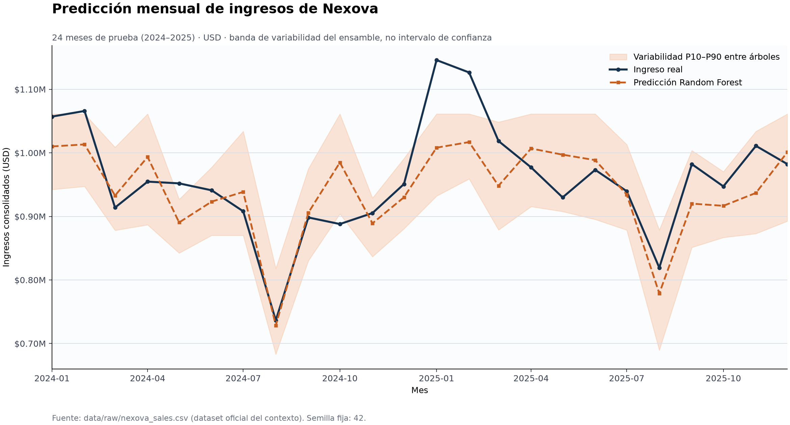

# Nexova Sales Forecast — Technical Summary

## Decision

Random Forest is the selected baseline because Laura and Finance need an
explainable feasibility model on only 96 training observations. It offers
feature importance and a transparent spread across its trees without the extra
tuning surface of XGBoost. The fixed seed makes the experiment reproducible.

## Test design

- Official dataset: 120 monthly consolidated rows, 2016-01 through 2025-12.
- Train: first 8 years (2016-01 through 2023-12). The first 12 months (2016)
  are warm-up rows without complete history for the 12-month lag/rolling
  features and are dropped, so the model fits 84 rows (2017-01 to 2023-12).
- Test: final 2 years (24 unseen rows, 2024-01 through 2025-12), evaluated as
  one-step-ahead forecasts (lags use the real previous months).
- Features (all causal, month t only sees data up to t-1): calendar
  trend/seasonality; revenue lags 1, 2 and 12; rolling means of 3 and 12
  months computed with `shift(1)` *before* `rolling`; and `active_contracts`
  and `avg_contract_value_usd` lagged one month. Same-month contracts and
  average contract value (whose product is almost the target) are not used.
  `tests/pipelines/test_sales_forecast.py` contains a no-leakage test.

## Test metrics

| Metric | Result | Interpretation |
| --- | ---: | --- |
| MSE | 3,164,183,646.24 USD² | Penalizes large misses quadratically. |
| MSE / mean revenue² | 0.34% | Dimensionless normalization of the squared error. |
| RMSE | 56,251.08 USD | Typical error in Finance-readable units. |
| RMSE / mean revenue | 5.86% | Scale-aware error against average test revenue. |
| PSI (revenue, train vs test) | 8.1274 | Cambio material de distribución. |
| Normalized Gini | 0.8132 | Ability to rank weak vs strong months. |
| K2 score | 0.5758 | Course label mapped explicitly to regression R². |
| P10–P90 band coverage | 79.2% | Descriptive tree spread, not a calibrated confidence interval. |

MSE alone is not sufficient: its squared units are difficult to budget against,
it does not reveal ranking quality, and it hides train-to-test distribution
shift. RMSE is therefore the primary Finance metric; Gini answers Laura's need
to distinguish August slowdowns from stronger January/February months, while
PSI warns that the recent period differs from the training population.

For future inference the model only needs data already closed: last months'
revenue, active contracts and average contract value. A previous version used
same-month contracts x average value, which is almost the revenue being
predicted and unknown in advance; that leakage was removed and the metrics
above are the honest causal ones.

`K2 score` is not a standard regression metric in scikit-learn. To keep the
course contract auditable, this implementation reports that label as R² (the
coefficient of determination) and stores the definition next to the value. See
the [official regression metric reference](https://scikit-learn.org/stable/api/sklearn.metrics.html#regression-metrics).

## Visualization

The band is the 10th–90th percentile across individual forest trees. It shows
model variability, but must not be presented as a calibrated probability or
confidence interval.
